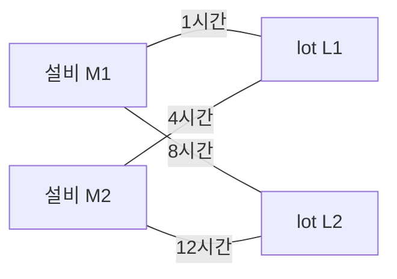

모델이 고른 설비–lot 조합과 실제 스케줄에 추가된 조합이 다르면, reward나 network 구조를 논하기 전에 연결부터 확인해야 한다. 처리시간이 lot 하나의 속성이 아니라 설비와 lot의 관계인데, 이를 잘못 표현해도 엉뚱한 선택이 나온다.

이번 글의 산출물은 **설비 node, lot node, 가능한 조합 edge로 이루어진 그래프의 schema와 선택 기록**이다. 01편의 두 설비·두 lot에서 시작해 한 snapshot의 스케줄을 순차 구성한다. schema는 이름뿐 아니라 값의 단위·시점·결측 처리·버전을 정한 계약이다. 아래 구조와 숫자는 설계 예시이며 실제 학습 결과가 아니다.

## 1. simulator가 아는 것과 policy가 알아도 되는 것은 다르다

**state는 환경의 상태이고, observation은 policy에 전달하는 관측**이다. simulator는 앞으로 발생할 고장 시각과 이번 작업의 실제 완료 시각을 내부적으로 이미 뽑아 둘 수 있다. 그것은 사건을 실행하기 위한 내부 정보다. 현장의 같은 decision 시점에 알 수 없다면 observation으로 내보내서는 안 된다.

이를 시각 $t$에서 사용할 수 있는 정보의 집합 $\mathcal I_t$와 관측 생성 함수 $g$로 표현하면 다음과 같다.

$$
o_t=g(\mathcal I_t),
\qquad
\mathcal I_t=\{x:\ t_{\mathrm{available}}(x)\le t\}
$$

이 식의 기준은 데이터에 찍힌 발생 시각만이 아니라 **의사결정 시스템이 실제로 이용할 수 있었던 시각**이다. 10시 발생한 고장을 10시 3분에 수신했다면, 10시 1분의 관측에 고장 확정 정보를 넣을 수 없다. 반대로 그때 이미 알려진 보전 계획은 미래 일정이라도 사용할 수 있다. 미래에 관한 모든 변수가 누수인 것은 아니다.

가령 10시 decision을 과거 로그로 복원할 때, 10시 8분에 완료된 작업의 실측 처리시간을 해당 lot의 예상 처리시간으로 채우면 결과를 앞당겨 본 셈이다. 예측 모델의 출력도 당시 사용 가능했던 모델과 입력으로 계산해야 한다. 전체 기간 데이터로 만든 평균·정규화 통계를 무심코 사용하면 평가 구간 정보가 전처리에 들어갈 수 있으므로, 학습 데이터에서 정한 변환을 고정한다.

관측이 부족하다고 simulator의 내부 변수를 모두 공개하는 것은 해결책이 아니다. 설비의 열화 정도를 직접 알 수 없다면 최근 고장 횟수, 가동 누적 시간처럼 운영에서 얻을 수 있는 이력으로 보완할지 판단한다. 지연과 부분 관측을 별도 문제로 다루어야 한다는 점은 현실 RL의 주요 난점과 연결된다. 어떤 이력을 얼마나 추가할지는 실제 의사결정의 개선과 수집 비용으로 검증해야 한다. [Dulac-Arnold et al., 2020](https://arxiv.org/abs/2003.11881)

## 2. 관측의 중심은 설비와 lot 사이의 관계다

부분 스케줄을 다음 이분 그래프로 표현한다. 이분 그래프는 서로 다른 두 종류의 node 사이를 edge로 연결하는 구조다.

$$
G_k=(V_M,V_L,E_k),\qquad
E_k=\{(m,j):j\text{가 미배정이고 }m\text{에 배정 가능}\}
$$

$V_M$은 설비 node, $V_L$은 lot node다. $k$는 생산 시각이 아니라 조합 선택 단계다. edge 하나가 이번 단계에 선택할 수 있는 `(설비, lot)` 조합에 대응한다. 처음 예제는 두 설비 모두 두 lot을 처리할 수 있으므로 edge가 네 개다.

L1의 처리시간은 M1에서 1시간이고 M2에서 4시간이다. 따라서 처리시간을 lot node의 값 하나로 넣으면 어떤 설비에서의 값인지 잃는다. 이 값은 **edge feature**로 두는 편이 자연스럽다. 반대로 이미 기다린 시간은 어느 설비에 붙일지와 관계없는 lot feature다.

| 위치        | 처음 필요한 feature                            | 의미                                         |
| ----------- | ---------------------------------------------- | -------------------------------------------- |
| 설비 node   | 예상 가용시각 $A_m^{(k)}$                      | 현재 부분 스케줄의 마지막 작업이 끝나는 시각 |
| lot node    | 미배정 여부, 준비 시각, 투입 시각              | 추가 배정 가능 여부와 체류시간의 기준        |
| 조합 edge   | 예상 처리시간 $\widehat p_{mj}$, 예상 완료시각 | 해당 설비에 지금 이어 붙였을 때의 비용       |
| 그래프 전체 | 미배정 수, 현재 최대 예정 완료시각             | 생성 진행 정도와 전체 계획의 요약            |

처음에는 $A_m^{(0)}=0$이고 모든 lot이 준비되어 있다. 이때 edge의 예상 시작·완료시각은 다음과 같다.

$$
\widehat S_{mj}^{(k)}=\max(A_m^{(k)},r_j),\qquad
\widehat C_{mj}^{(k)}=\widehat S_{mj}^{(k)}+\widehat p_{mj}
$$

$r_j$는 작업 준비 시각으로, 공장 투입 시각 $R_j$와는 다를 수 있다. 작은 예제에서는 둘 다 0이다. 예상값은 운영 시점에 이용할 수 있는 추정치이며, 실제 완료 후에 알게 된 처리시간으로 대체하지 않는다.

## 3. edge를 고르면 부분 스케줄과 그래프를 함께 갱신한다

첫 선택이 `(M1,L1)`이라고 하자.

1. M1의 작업열에 `L1: 0–1`을 추가한다.
2. M1의 예상 가용시각을 1로 바꾼다.
3. L1을 배정 완료로 표시하고 L1에 연결된 모든 선택 edge를 제거한다.
4. 남은 `(M1,L2)`와 `(M2,L2)`의 예상 완료시각을 각각 9와 12로 다시 계산한다.

**M1 node를 제거하지 않는다.** 한 설비에 한 lot만 붙이는 matching 문제와 달리, 이 과제는 설비별 작업열을 만든다. 같은 설비를 여러 번 골라도 되고, lot은 한 번만 배정한다. 배정된 lot node를 그래프에 남겨 이력을 표현할 수도 있지만, 선택 edge는 없어야 한다. 별도의 설비별 순서 목록에는 배정 이력을 보존한다.

다음에 `(M1,L2)`를 고르면 M1의 작업열은 `L1 → L2`가 된다. `(M2,L2)`를 고르면 두 설비에 하나씩 배정된다. 두 경우 모두 snapshot의 물리 시각은 0이다. 값 9와 12는 계획 안의 예상 완료시각이다.

모든 lot이 배정되어 edge가 없으면 정상 종료다. 미배정 lot이 남았는데 edge가 없으면 제약 충돌이나 후보 생성 오류를 조사하고 실패 경로로 보낸다. 임의의 첫 후보나 존재하지 않는 대기 action을 만들지 않는다. 실제 생산 사건을 기다리는 일도 이 생성 episode의 다음 step이 아니다.

## 4. policy는 가변 개수의 edge에 점수를 준다

설비·lot·edge의 feature를 이용해 node 표현 $h_m,h_j$를 만들고, 공유하는 점수 함수로 edge별 logit을 출력할 수 있다.

$$
z_{mj}=f_\theta(h_m,h_j,e_{mj},g_k),\qquad (m,j)\in E_k
$$

$e_{mj}$는 조합 feature, $g_k$는 그래프 전체의 요약이다. 단순한 시작은 원래 feature와 집계값을 쓰는 것이고, 더 복잡한 모델에서는 이웃 node의 정보를 주고받는 graph neural network를 검토할 수 있다. 예를 들어 M1을 공유하는 lot들이 서로 경쟁한다는 정보가 M1의 표현을 거쳐 각 edge의 점수에 들어가도록 설계한다. critic은 같은 부분 스케줄의 graph 표현에서 완성 스케줄의 return을 예측할 수 있다.

이 구조는 설비 수와 lot 수가 바뀌어도 같은 함수를 각 node·edge에 적용할 수 있다. 다만 가변 크기를 입력받는 능력과 큰 문제에서 좋은 스케줄을 만드는 일반화 능력은 다르다. 후자는 별도로 평가한다.

node나 edge의 저장 순서를 섞어도 ID에 대응하는 점수와 확률이 따라가야 한다. 이를 permutation equivariance라고 한다. 공유 함수와 순서에 무관한 집계로 설계하되, 구현에서는 ID를 유지한 채 그래프를 재정렬해 확인한다. 결정적 동점 해소 규칙도 ID 등 명시한 기준을 따라야 한다. 설비 ID를 유의미한 능력 feature 대신 외워 버리는지도 살펴본다.

고정 slot과 padding은 그래프를 GPU batch에 싣기 위한 구현 선택일 수 있다. 그 경우 빈 node·edge는 집계와 선택에서 제외한다. **행동의 의미는 edge가 나타내는 조합**이며 slot 위치가 아니다. 최대 node·edge 수와 전체 생성시간 한도는 따로 계약한다. edge를 일부 잘라 쓴다면 제외 기준과 누락된 lot을 기록하고, 전체 후보를 쓰는 baseline과 비교 범위를 구분한다.

## 5. 유효 edge와 mask를 학습 때도 보존한다

가능한 edge만 생성한다면 유효 집합 $E_k$에서 softmax를 계산할 수 있다. 전체 edge 목록과 mask를 유지하는 구현이라면, 유효 여부 $m_e\in\{0,1\}$와 logit $z_e$로 다음처럼 쓴다.

$$
\pi_\theta(e\mid G_k,m)=
\frac{m_e\exp(z_e)}{\sum_{e'}m_{e'}\exp(z_{e'})},
\qquad \sum_{e'}m_{e'}>0
$$

선택한 lot에 연결된 다른 edge는 다음 단계에 모두 무효가 된다. 설비 자격을 추가하는 확장에서는 자격 없는 조합도 제외한다. 금지 행동을 벌점만으로 교정하는 방식은 이 계약과 맞지 않는다.

학습 때 저장할 것은 선택한 edge ID만이 아니다. 당시 부분 스케줄과 edge feature, 유효 edge 집합, 선택 확률을 함께 남긴다. PPO의 과거 log probability를 재계산할 때 **그 선택 단계의 그래프와 mask**를 사용해야 한다. 완성 스케줄의 그래프나 이후 단계의 mask를 쓰면 같은 행동의 확률이 아니다. 상태 의존 masking과 policy gradient의 관계는 Huang과 Ontañón의 연구에서 다룬다. [논문](https://arxiv.org/abs/2006.14171)

세 edge의 지수화 점수가 $(2,3,5)$이고 유효 여부가 $(1,1,0)$이면 확률은 $(0.4,0.6,0)$이다. 둘째 edge를 고른 뒤 갱신 코드에서 mask를 빼면 확률이 0.3이 된다. parameter가 그대로여도 확률비가 $0.3/0.6=0.5$가 되어 잘못된 갱신 신호가 생긴다. graph를 어떻게 저장하든 이 확률 계약은 같다.

## 6. 복잡성은 필요한 관계에만 추가한다

처음 예시에는 설비 두 개, lot 두 개, 처리시간 edge만 있다. 이후 필요한 제조 조건을 다음 위치에 추가할 수 있다.

| 추가 조건             | 그래프·계약에서 바뀌는 곳                 | 검사할 영향                                         |
| --------------------- | ----------------------------------------- | --------------------------------------------------- |
| 설비별 처리 자격      | 해당 조합 edge 존재 여부                  | 미배정 lot의 가능한 설비가 잘못 사라지지 않는가     |
| 제품 전환 준비(setup) | 설비의 마지막 예정 제품과 edge의 전환시간 | 같은 설비에 append한 뒤 다음 edge 비용을 갱신하는가 |
| 납기                  | lot node의 납기와 예상 잔여시간           | makespan·TCT 외의 허용 지연도 평가하는가            |
| 관측 지연·결측        | node·edge 값의 수신 시각과 결측 표시      | 당시 사용할 수 없던 확정값이 섞이지 않는가          |

setup을 추가했다면 $\widehat C_{mj}$에 전환시간을 반영하고, 고정된 공통 예시와 구별해 확장 조건으로 기록한다. 실제로 여러 공정을 거치는 문제로 바꿀 때는 lot 하나가 아니라 다음 공정 작업을 배정하는지부터 권한을 다시 정의한다. 새 제약을 feature 하나로만 추가해 놓고 행동의 의미가 유지된다고 가정하지 않는다.

결측을 유효한 0과 구분하고 단위와 예측 모델 버전을 고정한다. 정규화는 허용된 training 자료로 계산해 평가·운영에서 같은 함수를 사용한다. 음수 처리시간을 모두 0으로 고치는 식으로 입력 오류를 숨기지 않는다.

## 7. 스케줄 전체와 각 선택 단계를 복원할 수 있어야 한다

| 기록           | 가상 예시                                                    |
| -------------- | ------------------------------------------------------------ |
| 요청·기준 시각 | plan P104, snapshot S88, 기준 10:00:00, 수신 10:00:02        |
| 생성 단계      | $k=1$, 이미 M1에 L1 배정, M1 예상 가용시각은 기준 이후 1시간 |
| 버전           | graph schema v3, edge 생성 v2, 정규화 v1, policy v5          |
| 유효 edge      | `[(M1,L2),(M2,L2)]`, snapshot·부분 스케줄 hash와 연결        |
| 출력           | 확률 `[0.4,0.6]`, 선택 `(M2,L2)`                             |
| 생성 결과      | M1: L1, M2: L2, 예상 makespan·TCT, 전체 생성 응답시간        |
| 실행 확인      | 스케줄 전체를 최신 상태에서 재검증한 결과와 예약·거절 사유   |

스케줄 생성 요청 ID, snapshot ID, 선택 단계 ID를 분리하면 여러 조합 선택을 여러 운영 요청으로 잘못 세지 않는다. 재생 검사에서는 node·edge 순서 변경, 중복 배정, 미배정 잔존, 후보 없음, 크기 초과를 함께 확인한다. 다음 편에서는 이 갱신과 완성 스케줄 평가가 시간과 비용을 올바르게 계산하는지 검증한다.

## 참고문헌

- Huang, Ontañón (2020 preprint; 2022 FLAIRS), _A Closer Look at Invalid Action Masking in Policy Gradient Algorithms_. [arXiv](https://arxiv.org/abs/2006.14171)
- Dulac-Arnold et al. (2020), _An empirical investigation of the challenges of real-world reinforcement learning_. [arXiv](https://arxiv.org/abs/2003.11881)

이전: [[posts/insights/rl-training-and-operations/02-kpi-and-reward|02. KPI와 reward]] · [[posts/insights/rl-training-and-operations/index|시리즈 목차]] · 다음: [[posts/insights/rl-training-and-operations/04-environment-validation|04. 학습 환경 검증]]
