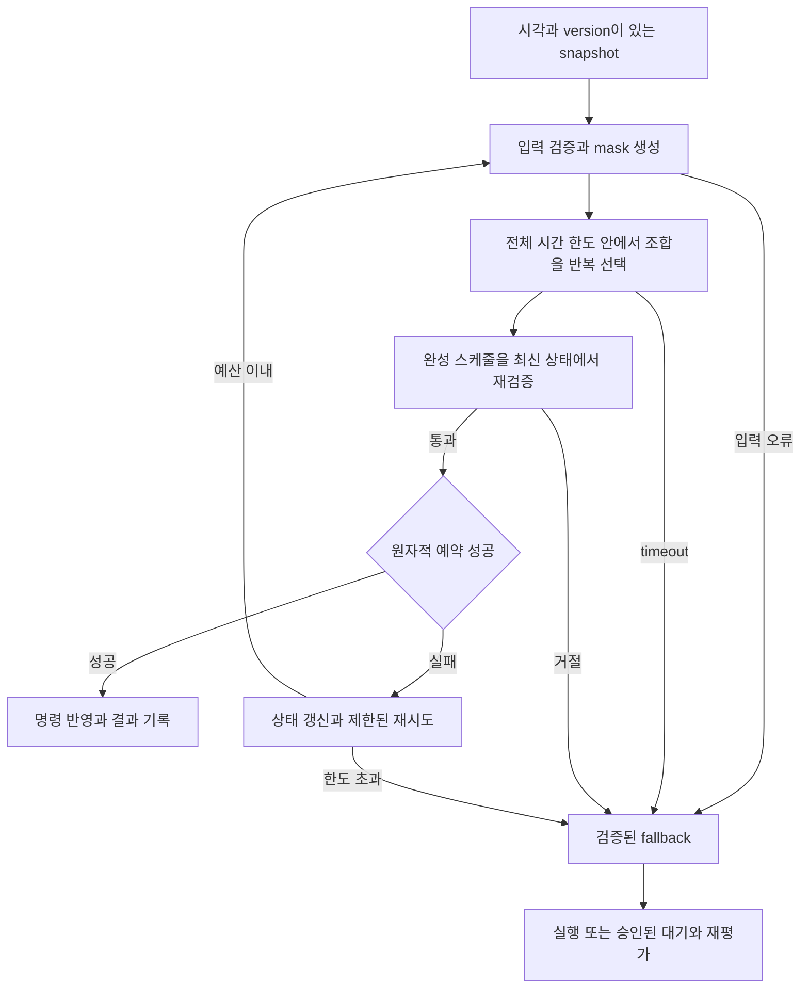

simulation에서 좋은 결과를 얻은 policy를 실행 서버에 올렸다고 배포가 끝나지는 않는다. 실제 경로는 snapshot 조회, 그래프 생성, 조합의 순차 선택, 완성 스케줄 검증, 예약과 명령 반영까지 이어진다. 첫 edge의 추론이 빨라도 스케줄 전체를 계산하는 사이 설비 상태나 lot 예약이 바뀌면 그대로 실행할 수 없다.

이 글에서는 한 snapshot의 대상 lot을 설비별 작업열에 모두 배정하는 공통 과제를 사용한다. 생성 중 선택은 내부 계산이며, 선택할 때마다 현장 명령을 보내지 않는다. 이 편에서는 최신 상태와 예약 충돌을 운영 조건으로 추가한다. 아래 bundle과 통과표는 가상 사례를 위한 설계 제안이며 실제 FAB 배포 성과나 업계 공통 표준을 뜻하지 않는다.

## 배포 대상은 모델과 주변 규약의 묶음이다

model weight가 같아도 입력 단위나 후보 순서가 달라지면 다른 행동을 실행할 수 있다. 그래서 배포 단위를 bundle, 즉 함께 검증하고 교체하는 구성 묶음으로 정의한다. 개별 파일의 version 외에 묶음 전체의 식별자를 남겨야 어떤 시스템이 결정을 내렸는지 재현할 수 있다.

| 구성 요소          | 함께 고정할 내용                                   | 어긋났을 때의 문제                   |
| ------------------ | -------------------------------------------------- | ------------------------------------ |
| 모델·runtime       | weight, 구조, 추론 모드, 의존성                    | 다른 checkpoint 또는 다른 계산 실행  |
| observation schema | 설비·lot node와 edge feature의 단위·시점·결측 처리 | 같은 숫자를 다른 의미로 해석         |
| normalizer         | 학습 때 정한 입력 변환 통계                        | 입력 의미가 조용히 변함              |
| action schema      | edge ID와 설비–lot 대응, append·종료 규칙          | 다른 조합을 붙이거나 대상 lot 누락   |
| mask·guard         | 자격 판정과 실행 승인 규칙                         | 선택 가능 집합 또는 실행 조건 불일치 |
| fallback           | timeout·오류·충돌 뒤 대체 처리                     | 제안 거절 후 처리 경로 누락          |
| 적용 계약          | snapshot 범위·node/edge 규모, KPI·가중치·TCT 한도  | 검증하지 않은 영역으로 적용 확대     |
| 검증 근거          | simulator, 데이터, 시나리오와 결과 version         | 배포를 승인한 이유 추적 불가         |

normalizer는 feature의 규모를 맞추는 변환이다. 운영에서 통계를 계속 갱신할지, 고정할지도 이 계약에 속한다. 통계를 바꾸면 weight를 그대로 두어도 실질적인 policy가 달라질 수 있다. action mask는 선택 가능한 행동을 제한하고, guard는 제안의 실행을 승인하거나 거절한다. fallback은 제안을 사용할 수 없을 때 적용할 검증된 대체 규칙이다.

bundle 검증에서는 파일 존재만 보지 않는다. 저장한 입력과 후보 목록을 다시 넣었을 때 동일한 조합과 완성 스케줄로 해석되는지 확인한다. 확률적 policy라면 난수 사용 규칙도 기록한다. 운영 중 mask만 긴급 수정해야 한다면 수정 이유와 영향을 남기고 그 조합을 재검증해야 한다. 독립적인 업무 제약 수정이 모델 성능까지 보장해 주지는 않는다.

## 실제로 실행되는 policy를 평가한다

모델 단독 평가와 보호 로직을 포함한 평가를 구분한다. snapshot $x$에서 조합 선택 policy를 반복해 완성 스케줄 $\widetilde B=\operatorname{Build}_{\pi_\theta}(x)$를 만든다고 하자. 실행 직전 상태 $x^+$에서 검사하는 대상은 마지막 edge만이 아니라 스케줄 전체다.

$$
B^{\mathrm{exec}}=
\begin{cases}
\widetilde B,&G(x^+,\widetilde B)=1\text{이고 예약에 성공하면},\\
b(x^+),&\text{그 외}.
\end{cases}
$$

$G$는 대상 lot의 중복·누락, 조합 자격, 설비 점유, snapshot 유효성을 검사하는 guard이고 $b$는 최신 상태에서 생성하는 검증된 대체 스케줄다. 모델의 내부 선택 순서와 설비별 실행 순서는 구분해 기록한다. fallback도 스케줄을 만들고 예약하는 전체 경로에서 유효해야 한다.

어려운 snapshot의 절반을 fallback이 대신한다면 전체 KPI가 좋아도 모델이 그 범위를 해결했다고 할 수 없다. 모델 스케줄, 실제 승인된 스케줄, 개입 사유를 별도로 기록한다. 순수 생성 policy는 능력과 실패를 보고, 배포 시스템은 조회·생성·guard·fallback을 포함해 평가한다. 응답시간도 edge 한 번이 아니라 **계획 요청 하나가 끝날 때까지** 측정한다.

고정 snapshot의 스케줄을 끝까지 실행하는 시험이 기본이다. 운영에서 주기적으로 새 snapshot을 받아 계획의 앞부분만 실행한다면, 실행할 prefix와 재계획 주기를 고정한 뒤 그 전체 시스템의 closed-loop 성과를 추가 평가한다. closed-loop는 실제 선택이 다음 상태를 만들고 그 상태에서 다시 계획하는 흐름이다. 고정 snapshot의 평균 개선만으로 반복 재계획의 운영 성과를 대신할 수 없다.

## 로그, simulation, shadow는 서로 다른 증거다

| 검증 방식              | 확보하는 근거                                  | 이것만으로 말할 수 없는 것                  |
| ---------------------- | ---------------------------------------------- | ------------------------------------------- |
| 로그 replay            | 입력 복원, 후보 대응, 지연, 과거 행동과의 차이 | 다른 선택 이후의 장기 KPI                   |
| OPE                    | 가정이 충족될 때 로그 기반 policy 가치 추정    | 로그가 뒷받침하지 않는 선택의 확실한 성과   |
| closed-loop simulation | 행동이 상태를 바꾸는 feedback와 장기 KPI       | simulator 밖 실제 현상까지의 검증           |
| shadow                 | 실시간 입력·추론·후보·version 처리             | 새 policy가 실제 생산 KPI를 개선했다는 증거 |
| 제한 적용              | 정한 범위에서의 실제 실행과 성과               | 다른 부하·제품·범위로의 자동 일반화         |

replay에서 기존 계획과 설비–lot 배정이 90% 일치했다고 가정해 보자. 이는 행동 비교 결과이며 90% 정확도나 성과 보장이 아니다. 같은 설비에 붙였어도 순서가 달라질 수 있고, 남은 10%가 전체 완료시각을 바꾸는 핵심 배정일 수도 있다. 과거 로그의 다음 상태는 기존 규칙의 행동으로 만들어졌으므로, 새 선택을 끼워 넣고 그 다음 로그를 그대로 따라가면 새 policy의 실제 trajectory가 되지 않는다.

OPE는 off-policy evaluation, 즉 다른 policy가 수집한 데이터로 목표 policy의 가치를 추정하는 방법이다. 적용하려면 목표 행동을 뒷받침하는 데이터 범위와 관측에 관한 가정을 확인해야 한다. 중요도 가중 방식은 분산, 모델 기반 방식은 모델 오지정에 민감할 수 있다. 결정적인 기존 규칙이 한 선택만 했다면 행동 확률을 기록하는 것만으로 대안 선택의 정보가 생기지는 않는다. [Uehara, Shi, Kallus의 OPE 리뷰](https://arxiv.org/abs/2212.06355)

따라서 OPE를 항상 가능하거나 항상 불가능하다고 정하지 않는다. 원본 snapshot과 각 단계의 edge 집합·선택, 완성 스케줄, 그 계획을 만든 절차, 당시 관측 정보부터 감사하고 적용 가정을 보고서에 적는다. 미기록 작업자 판단이 행동과 결과에 함께 영향을 주었다면 그 한계도 드러내야 한다. 추정치가 있다고 제한 적용을 생략할 근거가 자동으로 생기는 것은 아니다.

shadow는 기존 규칙이 계속 제어하는 동안 모델의 제안을 기록하는 운영 방식이다. 여기서 확보하는 것은 입력 지연, 장애, 후보 수 변동 같은 serving 증거다. 실제 완료시각은 기존 제어가 만든 것이므로 “shadow에서 makespan·TCT가 개선됐다”는 인과 주장은 성립하지 않는다. 또한 shadow에서 관측하는 상태 분포는 기존 policy 아래의 분포다. 새 policy가 만든 WIP까지 경험했다는 뜻도 아니다.

## 상태 확인과 예약을 하나의 실행 계약으로 묶는다

스케줄 생성 중 lot이 다른 요청에 예약되거나 처리 금지 상태인 hold로 바뀌면 이전 edge 집합만으로 실행할 수 없다. 최신 version과 자원 가용성을 확인하고, 확인과 예약 사이에 다른 요청이 끼어들지 못하도록 원자적으로 처리한다. 원자적 처리는 필요한 변경이 한 단위로 성공하거나 실패하도록 하는 것이다. 가능하면 스케줄의 예약을 한 단위로 성공·실패하게 한다. 시스템이 부분 예약만 지원한다면 성공한 항목 조회, 미실행 예약 해제·보상 처리, 나머지 계획 재생성 규칙을 따로 검증한다. 실패한 뒤 일부는 모델 계획, 일부는 fallback 계획으로 무작정 섞지 않는다. 재생성이 필요하면 최신 snapshot을 만들고 전체 응답시간과 재시도 한도를 적용한다.

timeout 뒤 늦게 도착한 결과는 기존 request가 이미 fallback으로 처리됐는지 확인해야 한다. request ID에 처리 결과를 연결해 같은 요청의 중복 명령을 막는다. 응답 유실로 성공 여부가 불명확한 경우에는 무조건 새 명령을 보내기보다 예약·명령 상태를 조회해 확정하는 절차가 필요하다. 검증 항목에는 서버 재시작과 응답 중복도 넣는다.

미배정 lot이 있는데 유효 edge가 없으면 생성 실패로 처리하고 fallback 또는 승인된 수동 경로로 보낸다. 생성 중에 생산 사건을 기다리는 action을 끼워 넣지 않는다. 실행할 작업 자체가 없는 운영 상황은 별도 대기·재평가 계약을 따른다. 이는 모델이 의도적으로 대기를 선택하는 action과 다르다. 이미 실행 중인 공정을 중지할지는 별도 현장 절차가 결정한다. DeepMind의 공개 데이터센터 제어 사례도 운영 제약, local controller의 추가 확인, 기존 제어로 돌아가는 경로를 설명한다. 이를 특정 RL 알고리즘의 FAB 실증으로 확대해서는 안 된다. [DeepMind 공식 사례](https://deepmind.google/blog/safety-first-ai-for-autonomous-data-centre-cooling-and-industrial-control/)

## 단계 전환은 일정이 아니라 증거로 결정한다

다음은 가상 과제의 배포 gate 예시다. gate는 다음 단계로 넘어가기 위한 조건이다. 응답 한도와 KPI 허용치는 임의 숫자로 정하지 않고 현행 시스템의 분포, 업무 요구, 02·05편의 계약에서 가져온다.

| 단계        | 통과에 필요한 증거                                         | 실패했을 때                     |
| ----------- | ---------------------------------------------------------- | ------------------------------- |
| bundle 검증 | schema·후보 대응 재현, 호환성 검사                         | 묶음 수정 후 replay 반복        |
| simulation  | held-out makespan·TCT, 시나리오별 한도, 완성 스케줄 유효성 | 적용 범위 축소 또는 후보 수정   |
| shadow      | 실제 입력 품질, 시간 한도, 충돌·중복 처리                  | serving 수정 후 관측 재개       |
| 제한 적용   | 실행 안정성, 충분히 관측된 KPI, 대체 경로 점검             | 신규 모델 명령 중단과 원인 분석 |
| 범위 확대   | 확대 대상 조건의 추가 증거, 운영 인수 완료                 | 현재 범위 유지                  |

보고서에는 실패도 남긴다. “shadow 2주 완료”만으로는 그 기간에 고장이나 제품 Q의 혼잡이 실제로 있었는지 알 수 없다. 예정 기간이 끝났어도 필요한 조건이 관측되지 않았다면 그 항목은 미검증이다. 대상 lot의 완료 결과가 아직 확정되지 않았을 때도 통과로 채우지 않는다.

승인 전에 남길 evidence checklist는 짧되 파일로 추적 가능해야 한다.

- 실행 bundle ID와 복구할 bundle ID가 평가 결과에 연결되어 있는가.
- 주판정 평균·TCT 한도·makespan 최소 이득·전체 생성시간 기준과 관측 대상이 고정되어 있는가.
- 통과·실패·미관측 시나리오가 구분되어 있는가.
- timeout, 중복, 예약 충돌, 입력 오류를 주입한 결과가 있는가.
- 현장 적용 단위, 담당자, 중단 권한과 복귀 절차가 정해져 있는가.

## FAB의 제한 적용은 공유 자원 간섭을 고려한다

lot을 무작위로 비교군 A/B에 나누어도 같은 설비를 공유하면 서로의 대기시간을 바꾼다. 다른 lot의 배정이 자기 결과에 영향을 주므로 독립적인 lot 비교로 단순 해석하기 어렵다. 적용 lot 수가 적어도 공통 병목을 건드리면 영향은 넓어질 수 있다.

분리 가능한 설비군 비교는 설비군 자체의 차이를, 시간 구간 교대는 이전 구간에서 넘어온 WIP를 다뤄야 한다. 어떤 단위가 최선인지는 현장 구조에 달려 있다. 적용 계획에는 간섭 경로, 전환 시 초기 WIP, 과도 구간 처리, 제품 mix와 부하 차이를 적는다. 기존 제어와의 비교가 어려운 관측 설계라면 결과를 확정적 인과 효과로 부르지 않는다.

이 편의 산출물은 bundle 목록, 단계별 근거, 미검증 영역, 제한 적용 범위를 묶은 배포 검증 보고서다. 승인 후에도 판단은 끝나지 않는다. 다음 편에서는 같은 bundle을 계속 쓸지, 멈출지, 새 후보로 바꿀지를 결정하는 운영 절차를 다룬다.

이전: [[posts/insights/rl-training-and-operations/09-generalization-and-robustness|09. 일반화와 견고성]] · [[posts/insights/rl-training-and-operations/index|시리즈 목차]] · 다음: [[posts/insights/rl-training-and-operations/11-monitoring-and-retraining|11. 운영과 재학습]]
